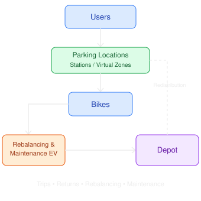

# Bike-Sharing System Operations and Rebalancing

#### Entities

- Parking Location (Virtual and Station)
    - Location
    - Capacity
    - Number of bikes available
    - Type
    - Discount Rate
- Bikes:
    - Location
    - State
    - Condition
- User
    - Location
    - State
    - User profile
- Rebalancing and Maintenance Eletrical Vehicle
    - Capacity
    - Location
    - Bikes being carried
    - Operational cost
    - State
- Depot
    - Location
    - Vehicles Capacity
    - Bikes Capacity
    - Number of vehicles
    - Number of bikes

Exogenous variables (IN):

- Temperature
- Weather Condition
- Time of the day
- Number of stations
- Number of Depots
- Number of vehicles
- Number of bikes per station
- Day of the Week

**Endogenous variables (OUT):**

- Waiting time for getting the bike per station
- Bike availability
- Number of users waiting
- Number of bikes in use
- Bike demand served
- Unmet bike demand
- Parking demand served
- Unmet parking demand
- Average waiting time
- Number of bikes requiring maintenance
- Operational cost
- Maintenance cost
- Revenue

Parameters:

- Maintenance Cost
- Operational Cost
- Price per minute of ride
- Fixed pick-up price

Stochastic processes

- Arrival of users
- Bike rental duration
- Bike return location
- Bike demand
- Parking demand
- Bike failures / maintenance requests
- Weather conditions

**Model type: Predictive and Prescriptive**

The model is **predictive** because it can estimate system performance, such as bike availability, unmet demand, waiting times, and operational costs, under different demand and environmental conditions. It is also **prescriptive** because it allows different operational strategies to be tested, such as rebalancing policies, fleet sizes, station capacities, pricing incentives, and maintenance policies, in order to identify configurations that improve the overall performance of the bike-sharing system.

**Uncontrollable variables:**

- Temperature
- Weather Condition
- Time of the Day
- Day of the Week
- User arrival patterns
- User destinations
- Trip duration
- Bike failures

**Controllable variables:**

- Number of stations
- Number of depots
- Number of vehicles
- Station capacity
- Fleet size
- Rebalancing policy
- Vehicle routing
- Maintenance policy
- Price per minute
- Fixed pick-up price
- Discount rate

**Questions to be answered by the simulation model:**

- What is the availability of bikes at each station?
- How many users are unable to find a bike?
- What is the average user waiting time?
- How often do stations become empty or full?
- How many bikes need to be rebalanced?
- What is the operational cost?
- What is the utilization of the bike fleet and rebalancing vehicles? improve! not very clear

**Operation Policies**

- Number of rebalancing vehicles
- Rebalancing policy (when a specific waiting time, increase price amount)
- Rebalancing threshold (  % of capacity \\\
- Number of bikes per rebalancing operation (specific number of bikes in a specific station to rebalance)
- Maintenance threshold (specific number of bikes to start fixing)
- Pricing policy (fixed, demand-based)
- Fleet size (conservative: increase based on demand, economic: minimal )
- Distribution policy (fixed: supply is set to a specific number of bikes per station, dynamic : context aware distribution of bikes per stations)

Random Variables

- 

**Project Goals**

The modeling of this project aims to develop a better understanding of how a bike sharing system might be implemented and maintained in an urban context. As such, a simulation of this system can help us analyze an measure:

- How the flow of users affects the allocation of bikes throughout a given time period:
    - Different urban areas may have different influx of bikes throughout the day;
    - Day of the week, weather conditions and temperature may affect system flux;
    - Providing more or less availability in key stations can largely impact the flow of bike traffic in the system.
- How bikes should be rebalanced around the city to provide better availability to users:
    - Different splits for stations with different demands may be taken into account;
    - Some stations/areas may be rebalanced naturally throughout the day by user flow patterns;
    - The ideal fleet size needs to provide enough availability to accommodate all users, but not overflow stations with bikes.
- How to manage maintenance resources to achieve a balance between revenue and operational costs;
    - Incentivizing bike usage in specific locations may help rebalance stations without the use of rebalancing vehicles;
    - 

Conceptual Model:

